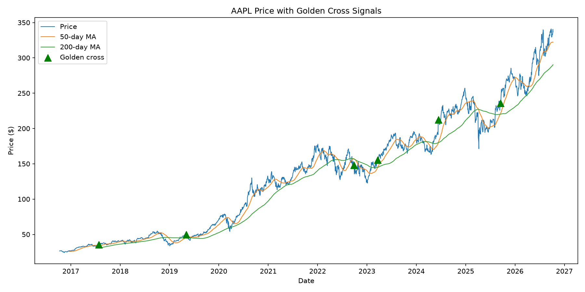

# golden-cross-screener
## v1.0: Golden Cross Screener

### What it does
This is a Python program that looks through stock prices and finds a buy signal called a **golden cross**. That's when a stock's 50-day average price goes above its 200-day average price. Some investors think this means a stock might keep rising. I wanted to see if that's actually true, so my program finds these signals and then checks what happened to the stock afterward.

### How it works
1. It downloads 2 years of daily prices for 8 large stocks (Apple, Microsoft, Google, Amazon, Tesla, Nvidia, Meta, and JPMorgan).
2. It figures out the 50-day and 200-day averages for each one.
3. It marks the days when the 50-day average crosses above the 200-day average.
4. It prints out any stock that had a golden cross in the last 5 days.
5. It saves all the data to CSV files and a database so I can use it later.
6. It makes a graph of one stock with green triangles where the golden crosses happened.
7. For each past signal, it checks how much the price changed over the next 60 trading days, then shows the average return and how often the stock went up.

### Tools I used
Python, pandas, yfinance, matplotlib, SQLite

### Problems with this version
- **Not enough data.** The 200-day average needs 200 days of prices, so with only 2 years there are very few signals. That means the results don't really prove anything.
- **No comparison.** Stocks usually go up over time anyway, so a positive result doesn't mean the signal worked. This version doesn't compare against just buying on a random day.
- **I picked the stocks.** All 8 are big, successful companies, which makes any strategy look better than it really is.
- **It ignores real costs.** It doesn't count trading fees or taxes.
- **It can crash.** If one stock fails to download, the whole program can stop.

### What I learned
I learned how to build a Python program that tests a specific stock strategy based on past stock data. I learned how to import stock price data through libraries such as yfinance, and how to use them in Python code to track buy signals. I also learned how to create graphs in code and plot specific markers to make interpreting the data easier. In addition, I now understand what backtesting is and how it can be a valuable financial tool to test markets and investing strategies. While working, I was first confused about how to import libraries and actually create the graphs, but after more testing and some fixes, I was able to produce this project. This is still just an entry-level project, and there is much more to be improved, but I thoroughly enjoyed working on the project and learning from it.

### What's next
These problems led to v2 (below), which I built with help from Claude, an AI coding assistant.

## v2.0: Improved Screener
Built with help from Claude, an AI coding assistant, after I wrote v1 myself.

### What changed
- Compares signals to buying on a random day, so I can tell if the signal actually helps
- Uses 10 years of data instead of 2
- Tests 20, 60, and 120 trading days after each signal
- Adds command-line options like `--tickers` and `--plot`
- Saves charts as images and skips stocks that fail to download

### Example chart

### How to run
    pip install -r requirements.txt
    python golden_cross.py

### Still limited
The stocks are hand-picked large companies, some results have small sample sizes, and fees and taxes aren't included.
